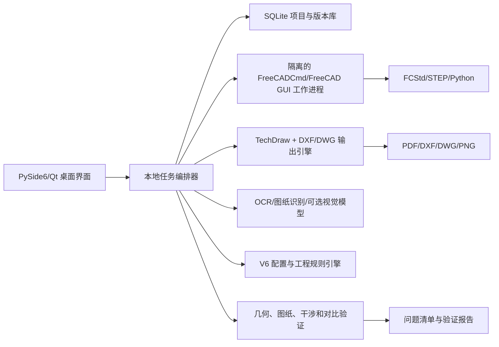

# 本地化 CAD 工程智能工作台构思

## 1. 产品定位

建议产品名称：`CAD 工程智能工作台`。

它不是单纯的 FreeCAD 宏管理器，而是一个本地项目制软件：用户导入二维图、三维模型或零件目录，选择任务和工程选项，软件执行建模、出图、装配、对比与验证，并保留每次迭代的证据和版本。

核心原则：本地优先、配置驱动、过程可见、错误可追溯、人工确认关键工程决策。

## 2. 主界面

采用三栏工作区：

- 左侧：项目树、零件树、装配树、任务与版本。
- 中间：PDF/二维图、三维模型或对比叠加预览。
- 右侧：当前任务参数、可勾选工程模块、待确认问题和验证结果。

顶部使用分段模式选择：

1. 二维转三维
2. 三维转二维
3. 装配体
4. 图纸审查
5. 对比验证
6. 新设计/优化

底部固定显示任务队列、FreeCAD 工作进程、日志、失败原因和当前输出目录。

## 3. 典型交互流程

### 三维转二维

1. 导入 FCStd/STEP。
2. 选择零件图或装配图。
3. 选择原图复现或工程增强。
4. 勾选剖视、尺寸、公差、形位、粗糙度、齿轮表、BOM 等模块。
5. 软件显示依赖项和缺失输入。
6. 生成草图预览并列出未解决问题。
7. 用户批准后生成 PDF、DXF/DWG 和 TechDraw 源文件。

### 二维转三维

1. 导入 PDF、图片或 DXF/DWG。
2. 自动拆分页、识别零件号、视图、剖视、尺寸和技术要求。
3. 在中间区域叠加识别结果，用户可修正。
4. 软件生成特征树和候选三维模型。
5. 对不唯一的深度、孔腔和装配方向进入“歧义队列”。
6. 生成投影视图与原图叠加比较。
7. 通过后输出 FCStd、STEP 和完整 Python 源码。

## 4. 技术架构

### 推荐技术栈

- 桌面界面：Python + PySide6，便于与 FreeCAD/Qt 生态整合。
- CAD 几何：FreeCAD、OpenCascade、FreeCADCmd 独立工作进程。
- 工程图：FreeCAD TechDraw 为主，自定义标注布局器补强；DXF 使用结构化库输出。
- DWG：通过经授权和验证的本地转换器；不能把“改扩展名”当作 DWG。
- PDF/图片：Poppler、Pillow/OpenCV。
- OCR：本地 OCR 为基础，复杂识图允许配置本地视觉模型或可选云端模型。
- 数据库：SQLite 保存项目、任务、零件、配置、问题、版本和证据索引。
- 后台任务：独立进程队列，防止 FreeCAD 崩溃拖垮主界面。

## 5. 本地化与隐私模式

提供三种模式：

- `完全离线`：规则、OCR、FreeCAD 和验证全部本地执行。
- `本地模型辅助`：使用本机 GPU/CPU 视觉模型，源文件不离开电脑。
- `可选云端推理`：仅在用户逐项目授权后上传指定页面或裁剪区域。

默认保存本地，不自动上传 GitHub，不自动发送供应商数据，不在日志中保存凭据。

## 6. 核心内部模块

1. 项目与版本管理器
2. 文件导入和格式预检
3. 图框/标题栏/视图/剖视识别器
4. 尺寸与符号语义识别器
5. 特征约束图
6. FreeCAD 参数化建模器
7. 原生装配树与关节管理器
8. 功能视图规划器
9. 尺寸、公差和形位规则引擎
10. 图面布局与碰撞检测器
11. 二维/三维对比验证器
12. 干涉、运动和装配顺序验证器
13. PDF/DXF/DWG/STEP/Python 导出器
14. 错误经验与可复用规则库

## 7. 为什么先做三维转二维

三维模型的几何相对确定，便于先建立稳定的视图规划、剖视、尺寸、排版和导出体系。二维转三维存在天然歧义，应在第二阶段以“机器生成候选 + 人工确认”实现。先完成三维转二维还能为二维转三维提供反向投影验证器。

## 8. 开发阶段

### 第一阶段：可用最小版本

- 项目管理与清晰文件夹版本。
- STEP/FCStd 导入。
- 三维转零件二维图。
- 视图/剖视选择。
- PDF、DXF、PNG 输出。
- 配置文件和任务日志。

### 第二阶段：工程标注

- 尺寸语义、基准、公差、形位和粗糙度模块。
- 原图复现/工程增强双版本。
- 图纸审查与阻断规则。
- AutoCAD 兼容输出验证。

### 第三阶段：装配

- 原生装配树、关节和自由度。
- BOM、气泡、装配剖视。
- 静态干涉、全行程、装配与拆卸路径。

### 第四阶段：二维转三维

- PDF/图片识别。
- 视图关联、尺寸约束和特征图。
- 歧义队列和候选模型。
- 三维反投影与多轮优化。

### 第五阶段：工程决策扩展

- 工况、材料、工艺、强度、安全系数。
- 成本、标准件、供应商和交期。
- 企业模板、标准库和审批流程。

## 9. 必须诚实面对的限制

- 任意二维图自动得到唯一三维模型在理论上并不总是可能。
- 公差不能仅根据几何自动确定，必须结合功能、工艺和检验。
- DWG 兼容性需要真实转换器和目标 AutoCAD 版本测试。
- FreeCAD TechDraw 可作为基础，但高质量自动排版需要额外布局引擎。
- 安全关键设计仍需要负责工程师、物理测试和正式批准。
